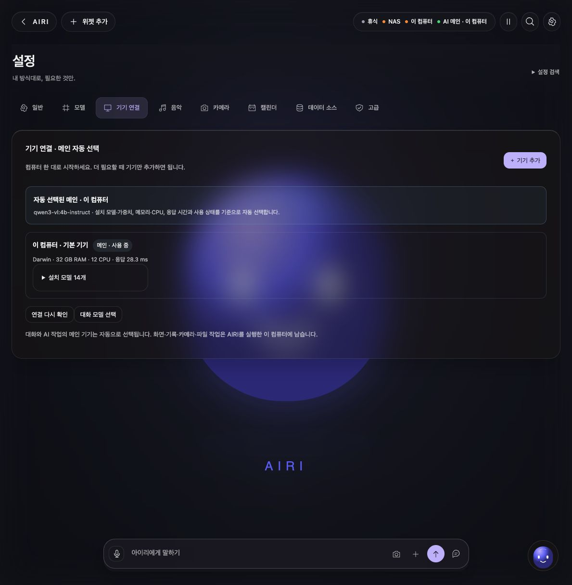
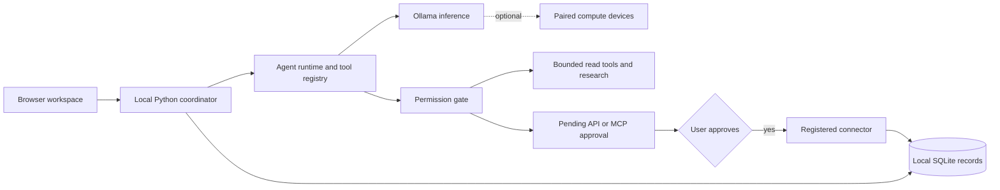

# AIRI Assistant

### Local-First Personal AI Workspace

A configurable personal AI workspace for local conversations, task planning, memory, research, voice, camera integrations and agent workflows. Includes an isolated Stock101 workspace.

**Community source release · v0.2.1 · Python 3.11+ · Personal and noncommercial use**

**Tool integration:** a local tool registry, public web research, registered HTTP APIs and
MCP tools with approval requests before external tool execution. See the
[code walkthrough](docs/ARCHITECTURE.md#tool-and-approval-path).


*Actual community build with a fresh local profile. The same computer runs the UI and records;
additional paired computers are optional.*

## Why this exists

Conversation, personal context and tool execution often live in separate applications.
AIRI brings them into one local workspace while distinguishing a proposed action, a pending
approval and an observed result. It can start with one computer and add inference capacity
without copying private conversations into a public project.

## Architecture at a glance



**Stack:** Python, SQLite, browser JavaScript/CSS, Ollama, HTTP/stdio MCP adapters and
optional voice/vision packages. [Architecture, code map and limitations →](docs/ARCHITECTURE.md)

[](https://github.com/Lvstw1205/airi-assistant/actions/workflows/checks.yml)

## What it does

- Local Ollama conversations, persistent history and configurable persona.
- Planner, task execution records, memory and work-journal tooling.
- Role registry and agent workflows for research, writing, coding and review.
- Research desk, news evidence, document ingestion and PDF report generation.
- Local voice and camera adapters, face personalization and hand controls.
- Single-computer setup, paired additional devices and automatic inference-main selection.
- Telegram command bridge, optional device workers and service connectors.
- Stock101 research, PAPER simulation and separately gated live adapter code.
- Neutral public avatar, optional user-supplied VRM and motion integration hooks.

## Quick start

macOS is the primary tested platform. Install Python 3.11+ and Git first. On Windows,
the standalone Vision/Stock101 Python host may run, but Windows packaging is not verified.
AIRI Assistant and Tim Works contain macOS/POSIX integrations.

```bash
git clone https://github.com/Lvstw1205/airi-assistant.git
cd airi-assistant
bash scripts/setup.sh
.venv/bin/python run.py
```

Open **http://127.0.0.1:8766** in your browser. On macOS you can also double-click
`Start.command` after downloading and extracting the source archive.

Install [Ollama](https://ollama.com/), start it and install the default local model:

```bash
ollama pull qwen3:4b
```

Open the app, select an installed model in settings and send a short message. The UI retains
the original Korean-first workflows. English prompts and user content are supported.

Optional functionality has separate dependencies and setup. See [the feature matrix](docs/FEATURES.md).
Private avatar artwork, voice likenesses, model weights, device pairings and external service
accounts are not distributed. A neutral original avatar is included.

## Data and operation

Your records are created in `data/`; downloaded models use `.runtime/` or `web/hand-assets/`.
These paths are excluded from Git. Nothing from the original owner's accounts, recordings,
conversations, credentials, face enrollments or trading ledgers is included.

The service runs while its Python process and computer are awake. Closing the browser does
not stop the server. Optional macOS login startup is installed with
`.venv/bin/python scripts/install_autostart.py`; use `--remove` to uninstall that launcher.
This is login startup, not execution while powered off. Keep the extracted folder in place.

## Public release history

This project was developed locally before its public release. The public repository starts
with a sanitized source import on **7 October 2026**; private records and the original
working history are not included. Subsequent fixes and documentation changes are recorded
as ordinary commits. The import date is not a claim that all development happened that day.

## Documentation

- [Architecture and code walkthrough](docs/ARCHITECTURE.md)
- [한국어 시작 안내](README.ko.md)
- [Setup and troubleshooting](docs/SETUP.md)
- [Privacy and data handling](PRIVACY.md)
- [Security reporting](SECURITY.md)
- [Release validation](docs/VALIDATION.md)
- [Third-party notices](THIRD_PARTY_NOTICES.md)

## License

Original code is **source-available under [PolyForm Noncommercial 1.0.0](LICENSE.md)**.
Personal and noncommercial use, modification and redistribution are subject to those terms.
Commercial use requires separate permission from the rights holder. This is not an
OSI-approved open-source license. Third-party code and models retain their own licenses.
Required attribution is in [NOTICE](NOTICE).

## Related projects

[AIRI Assistant](https://github.com/Lvstw1205/airi-assistant) ·
[AIRI Vision](https://github.com/Lvstw1205/airi-vision) ·
[Stock101](https://github.com/Lvstw1205/stock101) ·
[AIRI Playbook](https://github.com/Lvstw1205/airi-playbook) ·
[Tim Works Beta](https://github.com/Lvstw1205/tim-works-beta) ·
[AIRI Unhinged Voice](https://github.com/Lvstw1205/airi-unhinged-voice)

## 기기 추가 / Multiple computers

한 대로 시작하고 **Settings → 기기 연결 → 기기 추가**에서 필요할 때 연결하세요.
메인 추론 기기는 모델과 가용 성능을 기준으로 자동 선택됩니다.
[Device setup, automatic selection and limitations](docs/DEVICES.md)
